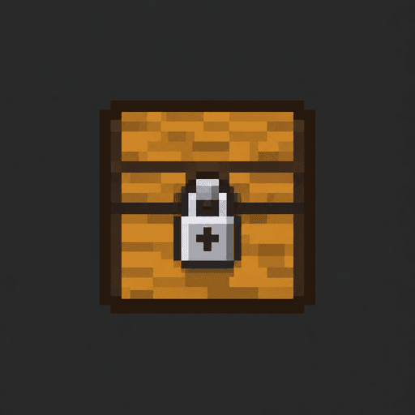

# QuickLock



Selective container protection for **Minecraft Java 26.3 / Fabric**, built from scratch under MIT.

**Status: alpha.** Automated policy and dedicated-server tests exist, including Lithium coverage. Real vanilla-client rendering, multiplayer acceptance, and the complete companion-mod stack still need the checks in [TESTING.md](docs/TESTING.md). Do not treat compilation or packet-level tests as proof of those behaviors.

Install QuickLock on the server only. Players need no client mod or resource pack. QuickLock adds no network port.

## How protection works

Place an eligible container, aim at it within normal interaction reach, then run `/lock`. Placement alone does not protect anything. Unlocked containers are public: anyone may open, break, and automate them. Only the recorded placer or a configured admin can lock a tracked container. Old or naturally generated containers without placement records cannot be claimed.

Lockable blocks: chests, trapped chests, barrels, all 17 shulker variants, furnaces, blast furnaces, smokers, brewing stands, hoppers, droppers, dispensers, and crafters. Double chests share one lock. Ender chests, hopper minecarts, other inventory blocks, and modded containers are not lockable.

| Role | Open/use | Add chest half | Break/pick up locked shulker | Unlock/manage trust |
| --- | --- | --- | --- | --- |
| Owner | Yes | Yes | Yes | Yes |
| Trusted player | Yes | Yes | No | No |
| Other player | No | No | No | No |
| Configured admin | Override | Override | Recovery override | Override |

Trust exists independently per container and per owner. Either grant gives player access. Removing one never removes the other. Owner-wide trust applies to future locks too.

When a trusted player expands a locked chest, both halves inherit the original owner and trust. A public double chest can be locked only when both halves belong to the command user, except for admin override. To fix mixed placement ownership, rebuild the public pair under one placer. Breaking one protected half leaves the survivor protected. Breaking ordinary containers removes their lock and placement ownership; replacement starts public under its new placer. Locked shulkers retain owner and local trust when moved.

## Commands

| Command | Result |
| --- | --- |
| `/lock` | Protect the aimed-at container you placed. |
| `/unlock` | Remove the whole targeted lock and make the container public. |
| `/trust <player>` | Add container-specific access. |
| `/untrust <player>` | Remove container-specific access; global/admin access may remain. |
| `/trust-all <player>` | Add access to all your existing and future locks. No target needed. |
| `/untrust-all <player>` | Remove owner-wide trust; individual grants may remain. No target needed. |
| `/lockinfo` | Show the targeted lock's owner only. |
| `/lockhelp` | Explain the commands privately. |
| `/lockview` | Toggle private red `Locked` / green `Unlocked` aiming labels. Off by default; remembered. |

Names autocomplete from players known to QuickLock. Unknown identities are rejected; ambiguous cached names require the player to join again. UUIDs remain authoritative across name changes. All feedback is private. Denials are rate-limited; labels do not affect protection or denial messages. Green `Unlocked` means **you have access**, not that the container is public.

## Automation

- A locked container can be pulled from only by a **locked block hopper with the same owner**. Public hoppers, other owners' hoppers, and hopper minecarts cannot steal from it. Player trust does not authorize machines owned by another player.
- Incoming automated items are allowed. Others can insert junk; locking protects access rather than reserving input slots.
- Hoppers may push output into public storage. Droppers, dispensers, and crafters continue normal redstone operation and output. Users are responsible for safe routing; emitted items and public destinations are public.
- Internal cooking, brewing, and crafting continue. Anyone can supply redstone power; QuickLock is not a redstone or land-claim system.
- Copper golems skip protected containers and cannot mutate them after a target becomes locked.
- Direct extraction through Fabric's container-storage adapter is denied for protected inventories because that API supplies no authenticated machine destination. Vanilla same-owner hopper pipelines remain supported.
- Locked portable shulker items cannot be collected by hoppers, minecarts, or normal mob pickup. Only their owner or configured admin may pick them up. Dropped items still have ordinary damage/despawn behavior.

## Installation and build

See [installation and recovery](docs/INSTALLATION.md), [test evidence and manual checklist](docs/TESTING.md), and [implementation plan](docs/IMPLEMENTATION_PLAN.md).

Build with Java **25**:

```sh
./gradlew build
./gradlew build -PwithLithium
```

The wrapper downloads checksum-verified Gradle 9.6.0. Builds run unit tests and dedicated-server game tests. Game-test configuration accepts the Minecraft EULA for the disposable local test server. Output: `build/libs/quicklock-0.1.0-alpha.1.jar` and matching `-sources.jar`. Do not install the sources jar.

Pinned development versions: Loom 1.17.21, Fabric Loader 0.20.1, Fabric API 0.165.0+26.3. Lithium test version: 0.26.2+mc26.3. Development server: `./gradlew runServer` after configuring its local EULA and server settings. Test data stays outside version control.

## Scope and limitations

No crafting, keys, signs, land claims, custom textures, client hooks, or custom client registry entries. Protection covers the implemented vanilla paths and the tested Fabric inventory adapter. Privileged commands, arbitrary third-party inventory mutation, removing QuickLock, and external world edits are not a security boundary.

Back up the **whole stopped server world**, including player data and `data/quicklock.json`, together. Chunk witnesses detect certain inconsistent world/data restores and stop protection rather than reopening containers. Atomic QuickLock JSON writes cannot make Minecraft's separate chunk and inventory saves one transaction; interrupted movement or mismatched backups may require recovery. This mod does not claim to repair Minecraft duplication exploits or reconstruct destroyed items.

MIT © 2026 Joseph Kelly. Runtime dependencies are not bundled. See [third-party notices](THIRD_PARTY_NOTICES.md).
